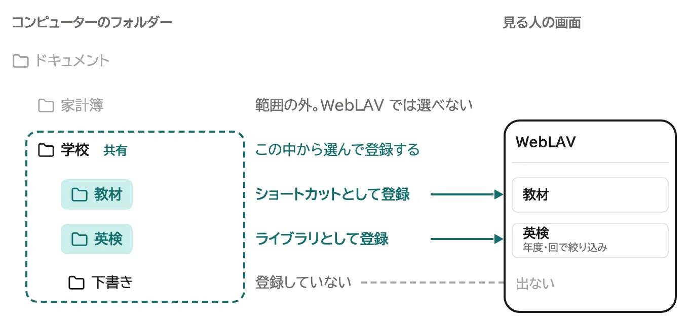
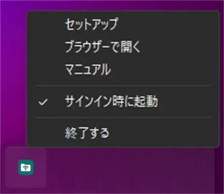
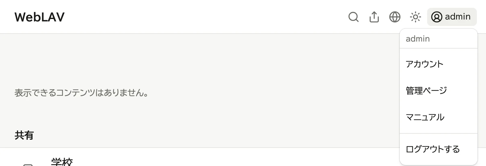
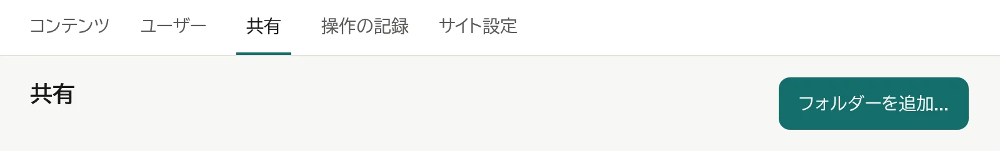
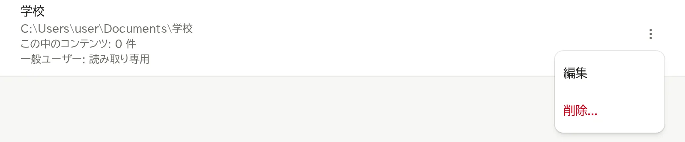
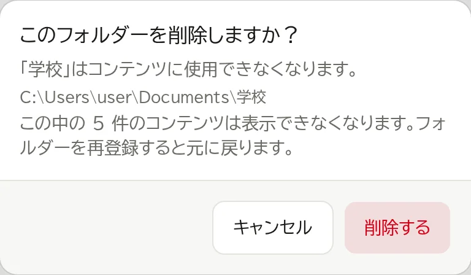

# 共有を追加する

「共有」は、WebLAV で扱ってよいと決めたコンピューターのフォルダーです。
共有の中では、ログインした人がファイルを見たり、足したり、動かしたりできます (→ [共有の中のファイルを扱う](05-files.md))。
見る人の画面 (ホーム) に出すには、共有の中のフォルダーやファイルを「ショートカット」として登録します (→ [コンテンツを登録する](06-register-content.md))。
**共有を追加しただけでは、ログインしていない人の画面には何も出ません。**

> **追加は、WebLAV を動かしているコンピューターで、`localhost` のアドレスで開いたときだけできます。**
>
> - スマートフォンやほかのコンピューターから開くと、「共有を追加...」のボタンが出ません。
> - 同じコンピューターでも、QR コードのアドレス (`http://my-pc.local:8370` など) で開くと出ません。
> - 場所の選び直しも同じです。名前の変更・権限・削除は、ほかのデバイスから開いた管理ページでもできます。

## 開く

1. WebLAV を動かしているコンピューターで、通知領域 (macOS はメニューバー、Ubuntu は画面右上) の WebLAV アイコンから「ブラウザーで開く」を選ぶ。開くのは `http://localhost:8370` です

   

2. 管理者でログインし、画面右上のユーザー名を押して「管理ページ」を選ぶ

   

3. 「共有」のタブを押す

   

## 追加する

1. 「共有を追加...」を押す

   

2. 開いたフォルダーを選ぶ窓で、共有にしたいフォルダーを選ぶ (Windows では「フォルダーの選択」、macOS では「開く」、Ubuntu では「選択」を押す)

選ぶとすぐに追加され、その共有の編集ページが開きます。名前はフォルダー名になります。続けて名前や権限を決められます。

一覧の行を押すと、いつでもその共有の編集ページが開きます。

`C:\` やユーザーのフォルダー全体のような広い場所は追加しないでください。中のファイルをすべて登録でき、権限によってはほかの人が動かしたり消したりできるようになります。

## 権限を決める

管理者は、どの共有でもすべての操作ができます。
一般ユーザーが共有の中でできることは、共有ごとに決めます。

| 権限 | できること |
|---|---|
| アクセス不可 | 共有が見えません |
| 読み取り専用 | 見る・ダウンロードする・ほかの共有へコピーする・ホームに載せる (既定) |
| 追加のみ | 読み取り専用に加えて、アップロード・新しいフォルダー・コピーで入れる。今あるものの名前の変更・移動・削除・上書きはできない |
| フルアクセス | 追加のみに加えて、名前の変更・移動・削除・上書き |

1. 共有の行を押して、編集ページを開く
2. 「権限」の欄で、「一般ユーザーの既定」を選ぶ
3. 既定と違う権限にする人がいれば、「ユーザーごとの例外」の「例外を追加」でその人を選び、行で権限を選ぶ。行の × で外すと既定に戻る
4. 「権限」の欄の「保存する」を押す

一覧には、一般ユーザーの既定 (「読み取り専用」など) と、例外の人数が出ます。

「アクセス不可」にした共有の中は、その人がコンテンツを登録するときのフォルダー選びにも出ません。

共有が別の共有の中にあるときは、外側と内側のうち強い方の権限が効きます。外側で見られる人は、外側から辿れば内側も見られるためです。

## NAS や外付けのディスクのフォルダーを追加する

NAS の共有フォルダーや外付けのディスクのフォルダーも、WebLAV を動かしているコンピューターから開ければ追加できます。

1. WebLAV を動かしているコンピューターで、先に NAS の共有フォルダーにつなぐ。パスワードを聞かれたら、保存する (Windows は「資格情報を記憶する」、macOS は「このパスワードをキーチェーンに保存」にチェックを入れる)
2. 「共有を追加...」を押し、開いた窓で NAS の共有フォルダーの中のフォルダーを選ぶ

パスワードを保存しないと、コンピューターを起動し直したときなどに、WebLAV が NAS へつなぎ直せません。

NAS やディスクにつながらないときは、一覧のそのフォルダーに「つながっていません」と出ます。見る人がそのフォルダーを開くと、つながらないと出ます。つながれば、そのまま見られるようになります。

NAS の共有フォルダーに書き込める人は、信頼できる人に限ってください。その人が置いたファイルも、見る人の画面に出ます。

NAS やネットワークのドライブでは、ごみ箱を使えません。共有の中で削除・上書きしたものは元に戻せません (→ [共有の中のファイルを扱う](05-files.md))。

## フォルダーを移したときは場所を選び直す

共有のフォルダーを別のディスクや NAS へ移したときは、共有を削除せずに、移した先を選び直します。名前と権限はそのまま残り、中に登録したコンテンツも、新しい場所の同じフォルダーを開くようになります。

1. WebLAV を動かしているコンピューターで、共有の行を押して編集ページを開く
2. 「場所」の欄の「フォルダーを選び直す...」を押す
3. 開いた窓で、移した先のフォルダーを選ぶ
4. 確認の画面で、新しい場所を確かめて「変更する」を押す

フォルダーの中身は、移す前と同じ並びのままにしておいてください。中のコンテンツは、新しい場所の同じ名前のフォルダーを開きます。

## macOS で書き込みの許可を取り直す

macOS では、前の版の WebLAV で追加した共有に、書き込みの許可がありません。そのままでは、共有の中でファイルを足したり動かしたりできません。管理ページの共有の一覧に「書き込みの許可がありません」と出たら、取り直します。

1. この Mac で、通知領域のメニューの「ブラウザーで開く」から管理ページの「共有」を開く
2. その共有の行を押して、編集ページを開く
3. 「場所」の欄の「フォルダーを選び直す...」を押し、開いた窓で同じフォルダーを選ぶ

## 名前を変える

名前は、コンテンツを登録するときのフォルダー選び・コンテンツの場所の表示・ホームの「共有」の区画に、パスの代わりに出ます。

1. 共有の行を押して、編集ページを開く
2. 「名前」の欄に名前を入れ、その欄の「保存する」を押す

## 削除する

> **削除しても、コンピューターの中のフォルダーとファイルは消えません。**
>
> 消えるのは、WebLAV の「共有」の一覧にある登録だけです。フォルダーは元の場所にそのまま残ります。

1. 共有の行の「⋮」を押し、「削除...」を選ぶ (編集ページの名前の右の「⋮」からも選べます)

   

2. 「削除する」を押す

   

中に登録したコンテンツは見られなくなりますが、登録は残ります。同じフォルダーを追加し直せば、また見られます。追加し直せるのは、WebLAV を動かしているコンピューターで開いたときだけです。

次は [共有の中のファイルを扱う](05-files.md) か、[コンテンツを登録する](06-register-content.md) に進みます。
