# 一覧の表示を設定する

フォルダーには、2つの見方があります。

- フォルダー: コンピューターの中の階層をそのまま辿る。いつでも使えます。
- 一覧: 中のファイルを1つの一覧に並べ、「年度」「回」などで絞り込めるようにする。使うかどうかを、フォルダーごとに決めます。

一覧の表示を使うと、見る人の画面の見出しの下に「フォルダー」と「一覧」が出て、見方を切り替えられます。ホームやグループから開くと、一覧の表示が開きます。

このページの設定は、そのフォルダーを登録した人と管理者ができます。
ほかの人が登録したフォルダーは、見ることだけができます。変更するときは、管理者に頼みます。

## 例: 年度と回で絞り込む

次のように並んだファイルの場合です。

```
録音
├─ 2024
│   ├─ 第1回
│   │   └─ main.mp3
│   └─ 第2回
└─ 2025
```

1. 「コンテンツ」の「追加...」で「フォルダー」を選び、「選択...」を押す

   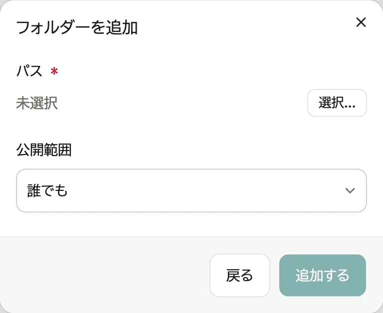

2. `録音` のフォルダーを開き、「このフォルダーを使用」を押す

   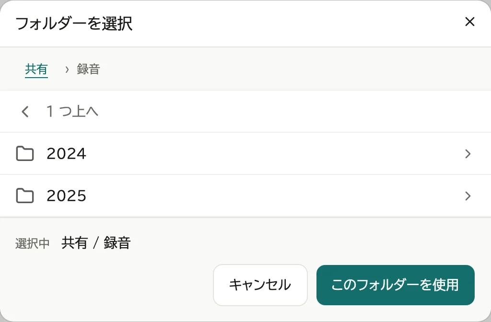

3. 「追加する」を押す。フォルダーの編集ページが開きます
4. 「基本情報」のタブで「一覧の表示を使う」をオンにし、「保存する」を押す。すぐにフォルダーをスキャンし、ボタンの横に進み具合が出ます。見せるファイルを選んで公開するときは、保存する前に「新しく見つかったファイルを公開する」をオフにします

   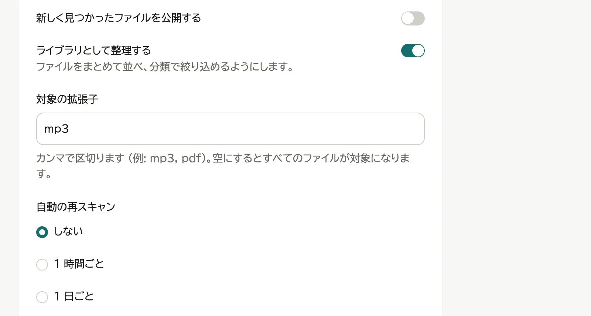
5. 「軸」のタブを押し、「軸を追加...」を押す

   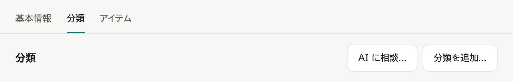

6. 軸名に「年度」を入れ、抽出元は「フォルダーの階層」、階層は「階層 1」を選び、「保存する」を押す

   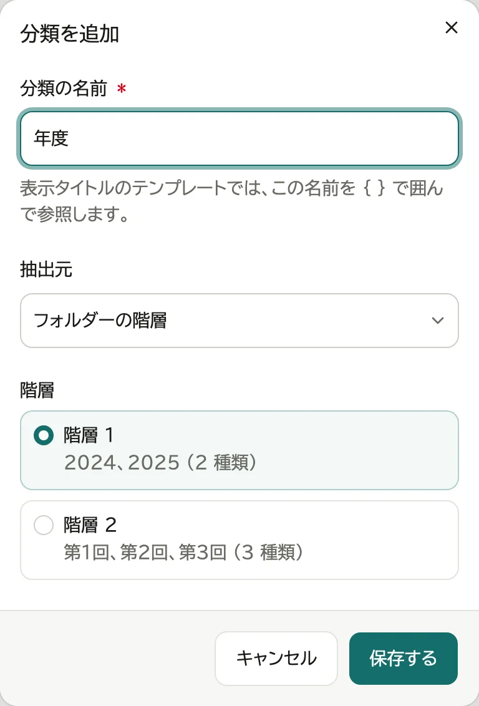

7. もう一度「軸を追加...」を押し、軸名「回」、階層「階層 2」で保存する
8. 「表示タイトルのテンプレート」を `{年度} {回} {fileName}` にし、「保存する」を押す

   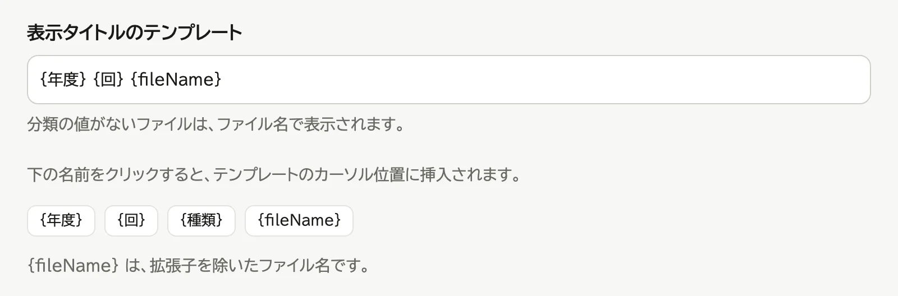

9. 「新しく見つかったファイルを公開する」をオフにしたときは、「アイテム」のタブを押し、見せるファイルにチェックを付けて「公開する」を押す

   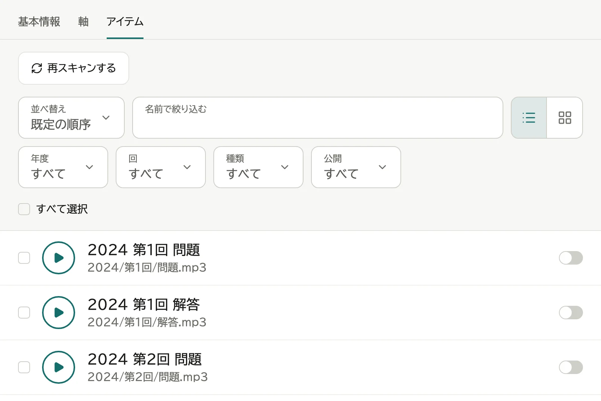

   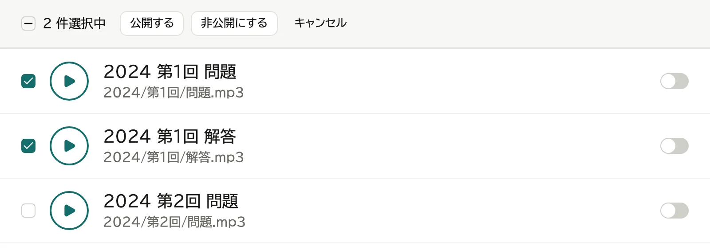

**オフにしたときは、9 を忘れると何も表示されません。**

「軸」と「アイテム」のタブは、一覧の表示を使うときだけ出ます。

## ファイル名の語で分ける

ファイル名に含まれる語 (例: `main`・`notes`) で分けるときです。

1. 「軸を追加...」を押し、軸名を入れ、抽出元に「ファイル名の単語」を選び、「保存する」を押す

   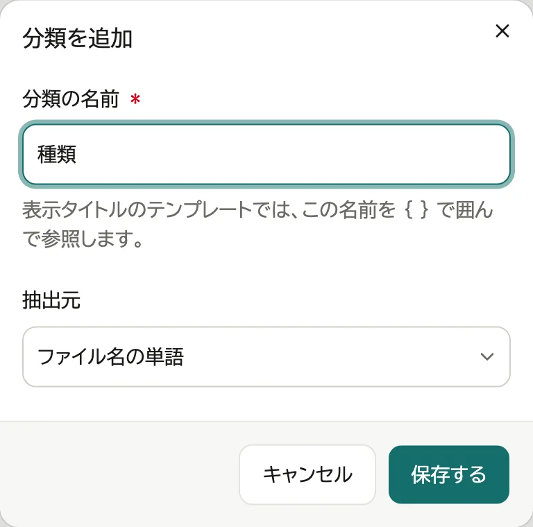

2. 追加した軸の行を押す
3. 「値を追加」を押し、元の値 (`main`) と表示名 (「本編」) を入れる。語の数だけ繰り返し、「保存する」を押す

   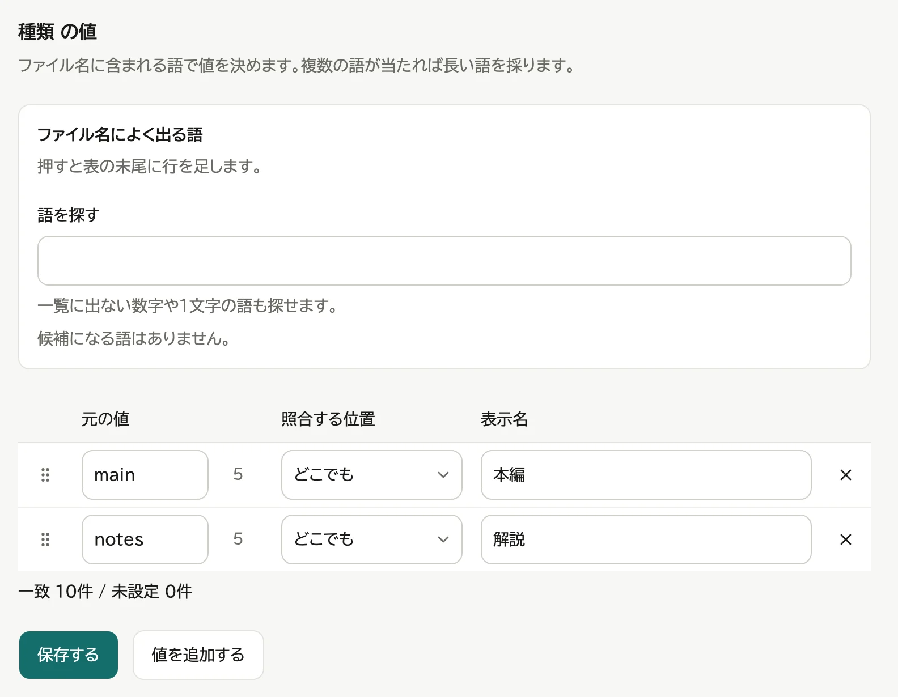

「一致位置」で、語がファイル名のどこにあれば当てるかを選べます。

- どこでも (既定): ファイル名のどこかに含まれていれば当てる
- 先頭か区切りの直後: ファイル名の先頭か、英数字以外 (記号・空白・日本語など) の直後にあるときだけ当てる
- 末尾: ファイル名の最後か、拡張子の直前にあるときだけ当てる

拡張子も照らすので、拡張子で分けたいときは `.md` や `.pdf` のように点を付けて登録します。

## 撮影日で分ける

写真を撮った年や月で分けるときは、「軸を追加...」で抽出元に「撮影日の年」か「撮影日の年月」を選びます。値は `2024` や `2024-06` の形になります。撮影日の無いファイル (動画や文書など) は、ファイルの更新日を使います。

フォルダーの階層の軸と同じく、軸の行を押して開く値の表で、表示名と並び順を変えられます。

## 載せるファイルを絞る

「基本情報」のタブの「対象の拡張子」(例: `mp3, pdf`) で、一覧に載せるファイルを絞ります。空ならすべてです。変えたら、「アイテム」のタブで「再スキャンする」を押します。

## AI に考えてもらう

軸の決め方に迷ったら、お使いの AI のサービス (ChatGPT・Claude など) に考えてもらえます。プロンプトと答えを自分で貼り付けるので、この手順では WebLAV が AI に送ることはありません。

1. 「軸」のタブで「AI に相談...」を押す。下の「WebLAV から AI に送る」を使える人には選ぶ画面が出るので、「ほかの AI サービスで作る」の「手順を表示」を押す
2. プロンプトをコピーし、AI のサービスに貼り付けて送る。プロンプトにはファイルのパスが入るので、人の名前などが入っていないかを確かめてください
3. AI の答えを「AI の回答を貼り付ける」の欄に貼り付け、「確認」を押す
4. 軸ごとに値が決まるファイルの数と、表示タイトルの例を見て、よければ「インポートする」を押す。直すときは「戻る」で答えの欄に戻る

インポートすると、今の軸と表示タイトルは置き換わります。インポートした後は、ほかの軸と同じように直せます。

### WebLAV から AI に送る

管理者がこのコンピューターを WebLAV のアカウントに登録していて、AI を使える人には、「AI に相談...」を押した最初の画面に「AI に送信して提案を取得する」が出ます (→ [AI の機能を使う](10-ai.md))。押すと、WebLAV がプロンプトを AI に送り、答えが返るとインポート後の内容を出します。貼り付けは要りません。

- そのフォルダーの中のフォルダーとファイルの名前が、WebLAV のアカウントのサーバーを通して Google (Gemini) に送られます。
- アカウントのクレジットを使います。
- 答えが返るまで、1分ほどかかることがあります。

## 軸を直す・削除する

「軸」のタブで、軸の行の「編集...」か「削除...」を押します。

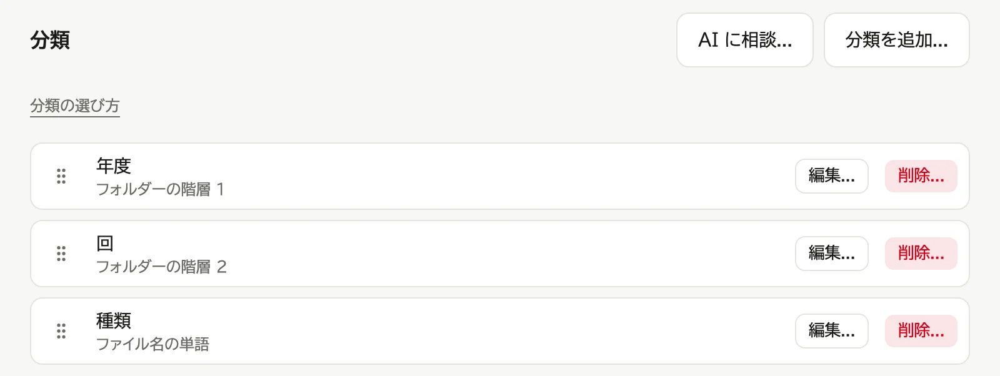

「編集...」で開く画面では、次も決められます。

- 絞り込みに出す: オフにすると、見る人の絞り込みに出さない。表示タイトルと並び順には使う
- 値が無ければファイル名のまま表示する: オフにすると、値の無いファイルはその部分を空にしてタイトルを組み立てる

抽出元か階層を変えて保存すると、その軸の値の表は消えます。

## 並び順を変える

- 絞り込みの並び: 「軸」のタブで、軸の行の頭にあるつまみをドラッグする
- 値の並び: 値の表の行の頭にあるつまみをドラッグする

## ファイルを足した・消したとき

一覧を開くと、前のスキャンから中身の変わったフォルダーだけを読み直します。足したファイルは再スキャンしなくても一覧に出て、消したファイルは一覧から外れます。

ファイルの中身を書き換えたとき (同じ名前のまま写真を差し替えた など) は、再スキャンで読み直します。

1. フォルダーの編集ページの「アイテム」のタブで「再スキャンする」を押す

   

   ファイルが多いと時間がかかり、ボタンの横に進み具合と経過時間が出ます。画面を閉じても、スキャンは最後まで続きます。

決まった間隔で再スキャンするときは、「基本情報」のタブの「自動の再スキャン」で「1 時間ごと」か「1 日ごと」を選びます。

足したファイルは、「新しく見つかったファイルを公開する」がオンなら公開され、オフなら非公開で入ります。非公開で入ったものを見せるときは、チェックを付けて「公開する」を押します。


公開をやめるときは、チェックを付けて「非公開にする」を押します。一覧の表示で、行の「⋮」から「非公開にする」を選んでもやめられます。公開・非公開はフォルダーの表示と同じものを使うので、片方で変えるともう片方にも効きます (→ [コンテンツを登録する](05-register-content.md))。

## ファイルやフォルダーが見つからないとき

- フォルダーの中でファイルを移したり名前を変えたりすると、新しく見つかったファイルとして入ります。「新しく見つかったファイルを公開する」がオフなら非公開に戻るので、もう一度公開してください。

再スキャンで次のように出たときは、アイテムの一覧も公開の設定も変わっていません。

- **「フォルダーが見つかりませんでした。」**: 登録したフォルダーを消したか、移したか、名前を変えたか、外付けのドライブを外しています。
  - 移したか名前を変えたなら、「基本情報」のタブの「パス」の「変更...」を押して選びます。公開・非公開の変更と一覧の中身は消えるので、設定し直します。
  - ドライブを外したなら、つないでから再スキャンします。
  - 見る人の画面にも「フォルダーが見つかりませんでした。」と出ます。
- **「「(フォルダー)」を読み取れませんでした。」「フォルダーを読み取れませんでした。」**: WebLAV がそのフォルダー (後のほうは登録したフォルダーそのもの) を読めません。コンピューターでそのフォルダーのアクセス権を確かめ、読めるようにしてから再スキャンします。NAS の共有なら、つながっているかを確かめます。
- **「ファイルが 100,000 個を超えているため、一覧にできません。」**: 1つのフォルダーの一覧に入れられるファイルの数を超えています。「基本情報」のタブで拡張子を絞り込むか、中のフォルダーを別々のフォルダーとして登録します。
