# コンテンツを登録する

## 種類

| 見せたいもの | 種類 |
|---|---|
| コンピューターの中のフォルダーやファイル | ショートカット |
| 年度や回で絞り込める一覧 | ライブラリ (ショートカットを作ってから切り替えます → [ライブラリを設定する](07-archive-setup.md)) |
| 外部サイトの URL | リンク |
| いくつかをまとめる | グループ |

ショートカットで選べるのは、「共有」の中だけです (→ [共有を追加する](04-shares.md))。
実ファイルを動かさずに、グループで別の整理をしたいときにも使います。手元のファイルを見せたいときは、先に共有の中にアップロードします (→ [共有の中のファイルを扱う](05-files.md))。
見る人の画面に出るのは、ここで登録したものだけです。

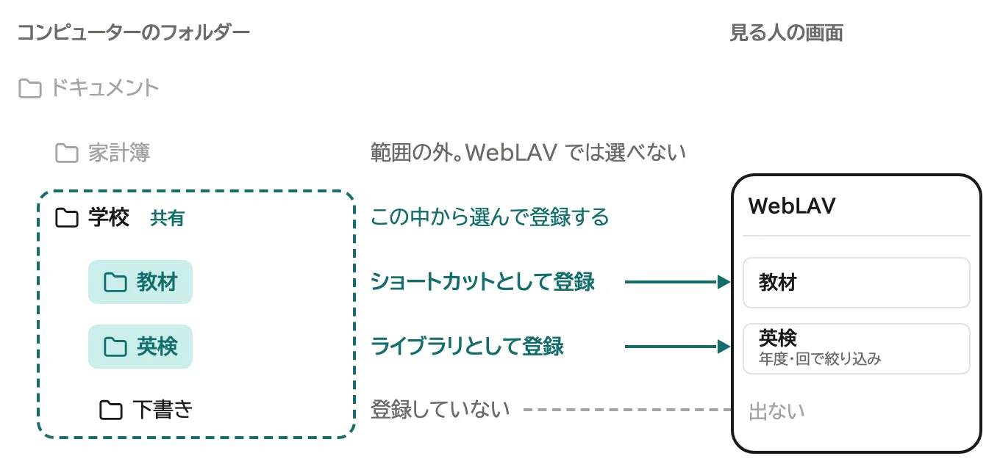

タイトルは自動で付きます。直すときは、登録後に開く編集ページで直します。

## 始める

ホームかグループの画面で、見出しの右の「追加」を押し、種類を選びます。グループの画面からなら、そのグループの中に入ります。

管理者は、管理ページからも追加できます。

1. 管理ページの「コンテンツ」のタブで「コンテンツを追加...」を押す

   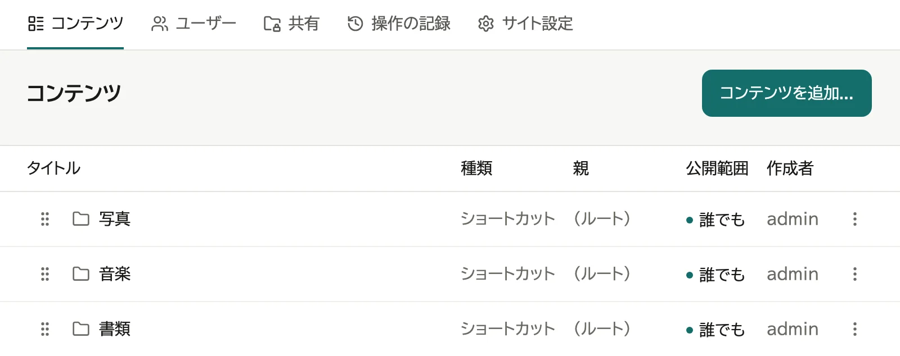

2. 種類を選ぶ

   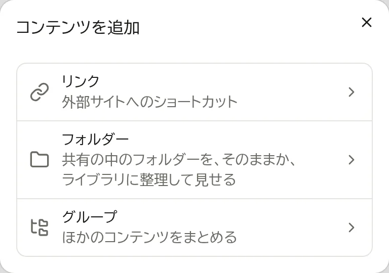

続きは種類ごとに違います。

## ショートカット

1. 「選択...」を押す

   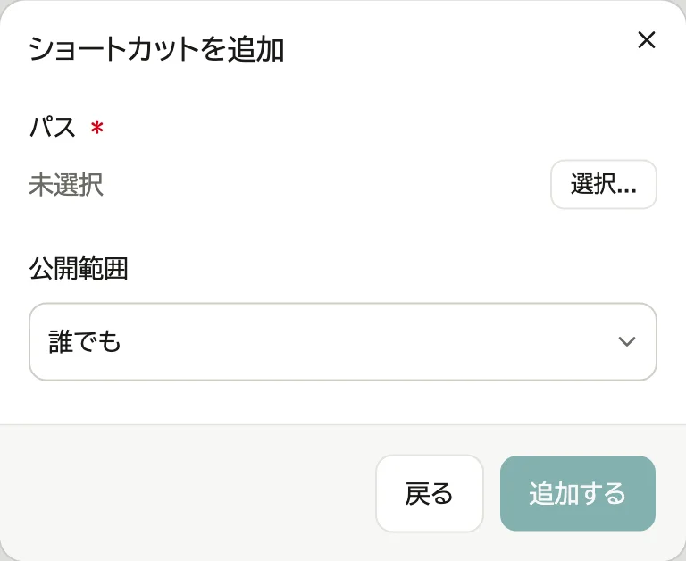

2. 共有から辿って、フォルダーならそこを開いて「このフォルダーを使用」を押す。ファイルなら、それを押して「このファイルを使用」を押す

   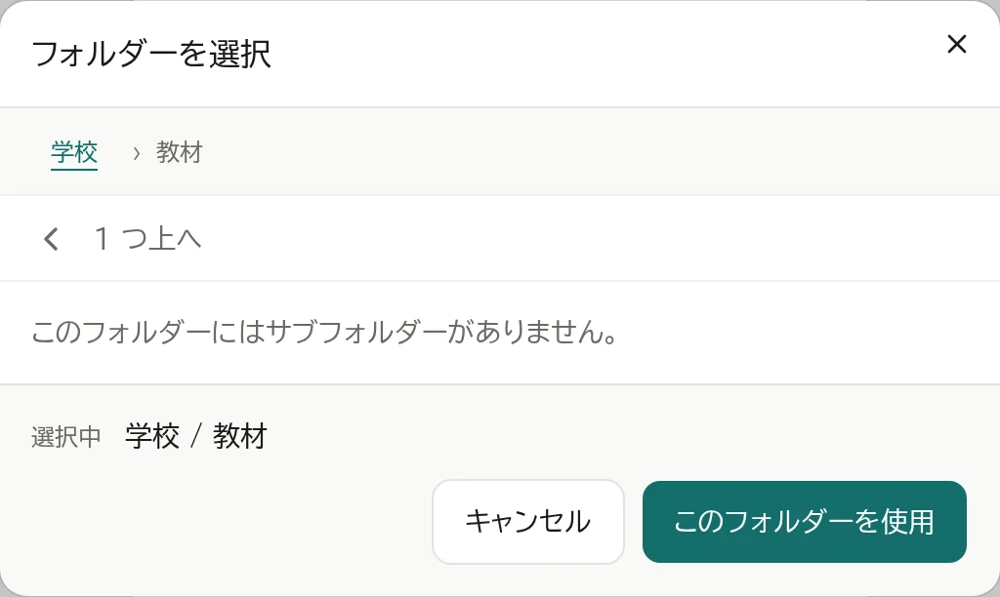

3. 「追加する」を押す。フォルダーを選んだときは、確認の窓で「登録する」を押す

   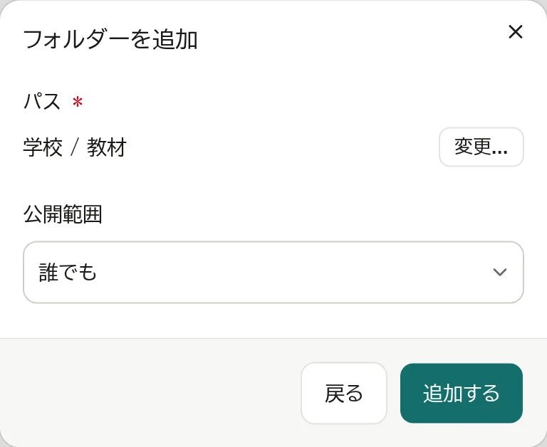

共有の画面のフォルダーやファイルの行の「⋮」の「ホームに載せる...」でも作れます (→ [共有の中のファイルを扱う](05-files.md))。

### ファイルを指すショートカット

一覧のファイルと同じように開きます (→ [ファイルを見る](08-viewing.md))。画像・PDF・動画・テキスト・Office の文書はその場のビューアーで、音声は行のプレイヤーで、名前が `.links.toml` で終わるファイルはリンクの一覧で開きます。開けない種類はダウンロードします。同じ一覧に並ぶファイルの間で前後に移れ、音声は続けて再生できます。

共有の画面で先のファイルの名前を変えたり動かしたりすると、ショートカットは付いていきます。エクスプローラーや Finder で動かす・名前を変えるか、ファイルを消すと、行は残ったまま、開くと「ファイルが見つかりません。」と出ます。編集ページの「パス」の「変更...」で選び直します。

ファイルを指すショートカットには、パターンの欄はありません。ライブラリにもできません。

### 見せるものを絞る

フォルダーを指すショートカットの中のものは、既定ではすべて見えます。見せるものは、「場所と見せ方」の「対象のパターン」と「除外のパターン」で絞れます。「編集...」を押し、1行に1つ書いて「このパターンにする」を押し、その区画の「保存する」を押します。

- `*.pdf`: どの階層でも、名前が合うファイル
- `backup/`: どの階層でも、その名前のフォルダー
- `docs/*.pdf`: 一番上の「docs」の直下のファイル (`/` を含むものは、フォルダーの一番上から見ます)

対象が空ならすべてが対象で、除外は対象より優先します。外れたものは、変更できる人にも見る人にも、フォルダーの画面・ダウンロード・検索のどれにも出ません。共有の画面には出ます。対象だけを書いたときは、当てはまるファイルが中に無いサブフォルダーも並びます。

パターンの保存で見えるファイルが増えたり減ったりするときは、保存の前に件数が出ます。

## リンク

1. URL を入れ、「追加する」を押す

   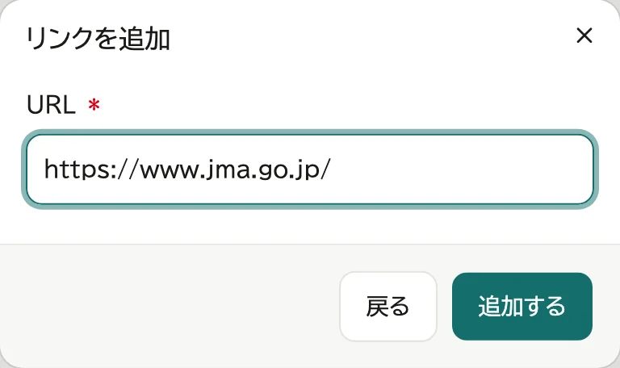

リンクをまとめて見せるときは、名前が `.links.toml` で終わるテキストファイルに書き、フォルダーに置きます。
開くと、中のリンクが、リンクを登録したときと同じ形で並びます。

```toml
title = "今朝のおすすめ"

[[links]]
url = "https://example.com/"
note = "リンクの下に出す説明 (省いても構いません)"
```

- リンクは `[[links]]` ごとに書きます。並びは書いた順です。
- `title` を省くと、ファイル名が題になります。
- 文字コードは UTF-8 で保存します。読めない書き方のときは、その旨と、ファイルを新しいタブで開くボタンが出ます。

## グループ

1. タイトルを入れ、「追加する」を押す

   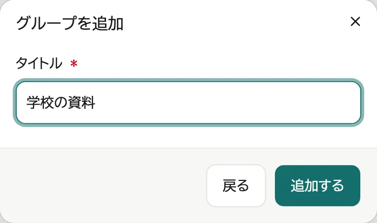

## 公開範囲を変える

| 公開範囲 | 見える人 |
|---|---|
| 誰でも | ログインしていない人も含めて全員 (既定) |
| ログインした人 | ログインした人だけ |
| 作成者のみ | 一覧に出るのは登録した本人だけ (管理者は管理ページから開ける) |
| 非表示 | 一覧には出ない (登録した本人と管理者は、ユーザー名のメニューの「非表示のコンテンツ」から開ける) |

1. 「コンテンツ」の一覧で、行を押す (行の「⋮」の「編集」でも開けます)

   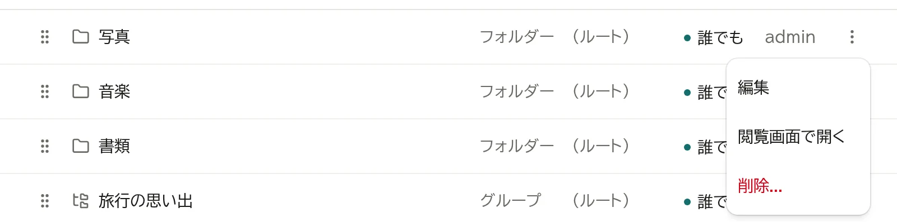

2. 「公開範囲」を選び、「保存する」を押す

   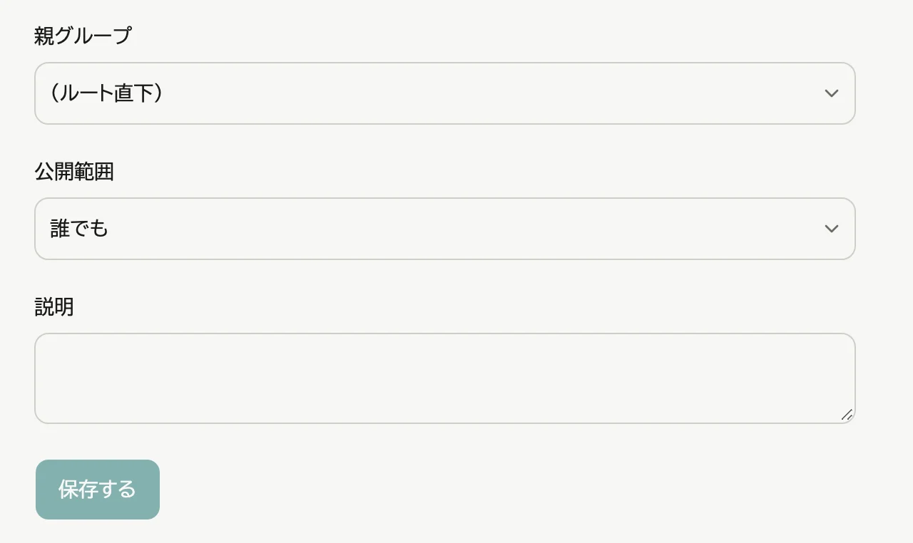

ホームやグループの一覧からも変えられます。自分が登録したもの (管理者はすべて) の行の「⋮」を押し、「公開範囲...」を選んで公開範囲を選びます。「編集」で編集ページが開きます。

グループの中に入れたものは、グループの公開範囲も満たす人にだけ見えます。

公開範囲は、コンテンツとしての見え方を決めるものです。フォルダーの中のファイルは、公開範囲によらず、その共有を見られる人なら共有の画面から見られます。

## 非表示にする・表示に戻す

ホームやグループの一覧で、行の「⋮」を押し、「非表示にする」を選ぶと、その場で一覧から消えます。すぐに戻すときは、出てきた知らせの「元に戻す」を押します。

非表示にしたものは、画面右上のユーザー名のメニューの「非表示のコンテンツ」に並びます (自分が登録したもの。管理者にはすべて)。

1. 画面右上のユーザー名を押し、「非表示のコンテンツ (件数)」を選ぶ
2. 行の「⋮」を押し、「表示に戻す」を選ぶ

非表示にする前の公開範囲に戻ります。「作成者のみ」だったもので作成者のユーザーが削除されているものは、戻す先が無いので「表示に戻す」が出ません。編集ページの「公開範囲」で選び直します。「⋮」からは、編集・削除もできます。

グループを「作成者のみ」にすると、自分だけの置き場になります。中に入れられるのは自分の「作成者のみ」のものだけで、中に追加すると公開範囲は「作成者のみ」になります。ほかの人のものや「作成者のみ」でないものが入っているグループは、「作成者のみ」にできません。

## グループに入れる

新しく入れるとき:

1. グループの行の「⋮」を押し、「中に追加...」を選ぶ

   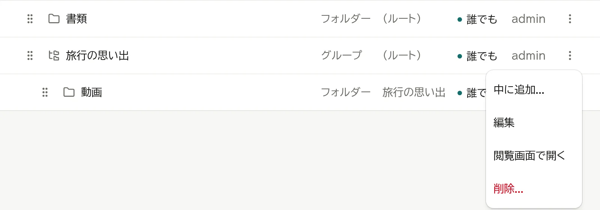

2. あとは「始める」の2から同じ

登録済みのものを移すとき:

1. 行を押して編集ページを開く
2. 「親のグループ」を選び、「保存する」を押す

   

## 内容を変える

行を押して編集ページを開き、直して「保存する」を押します。

見る人にどう見えるかは、編集ページの見出しの横の「閲覧画面で開く」で確かめられます (一覧の行の「⋮」にもあります)。そのコンテンツが並ぶ、入っているグループの画面 (グループに入っていなければホーム) が開きます。「非表示」のものと、ほかの人の「作成者のみ」のものは、そこに並ばないので、それ自体が開きます (前から登録してある画像などのファイルは、グループの画面のままです)。

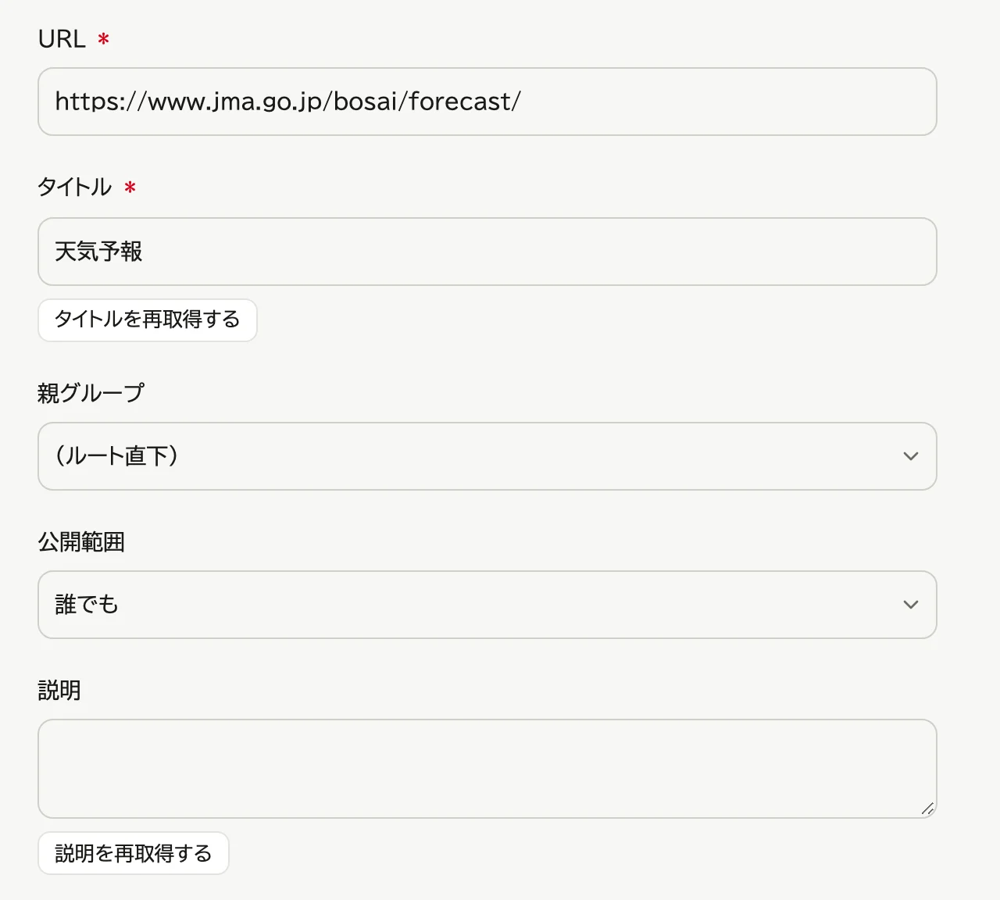

- タイトル・説明
- リンク: 「タイトルを再取得」「説明を再取得」で、リンク先から取り直す
- ファイル (前の版で登録したもの): タイトルなどは直せますが、ファイルは差し替えられません。中身を変えるときは、共有の中に置き直します
- フォルダーを指すショートカット: 「対象のパターン」「除外のパターン」(→ 上の「見せるものを絞る」) と「ライブラリとして整理する」(→ [ライブラリを設定する](07-archive-setup.md))。どちらも追加するときには聞かれないので、ここで変える
  - 「パス」の「変更...」で場所を変えると、一覧の中身はすべて消える

## 削除する

1. 行の「⋮」を押し、「削除...」を選ぶ

   

2. 「削除する」を押す

   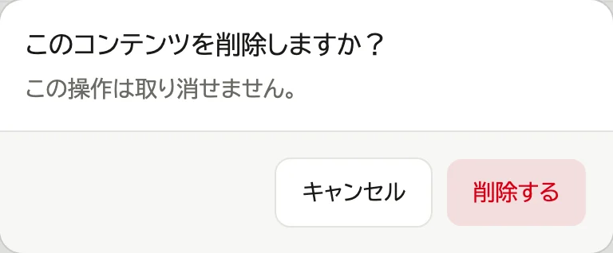

編集ページの見出しの横の「⋮」→「削除...」からも削除できます。削除すると一覧に戻ります。

- ショートカットやライブラリを削除しても、コンピューターの中のファイルは消えません。
- グループを削除すると、中のものはグループの外 (一番上) に出ます。
