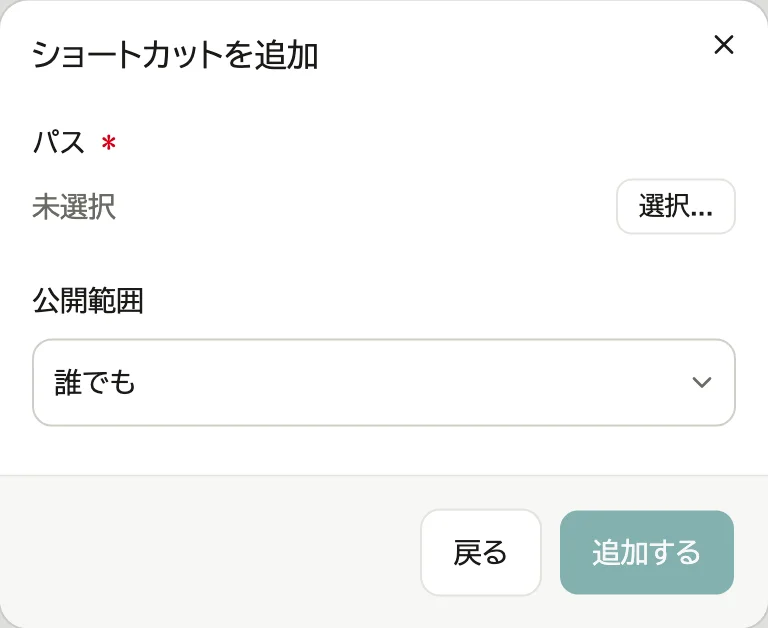
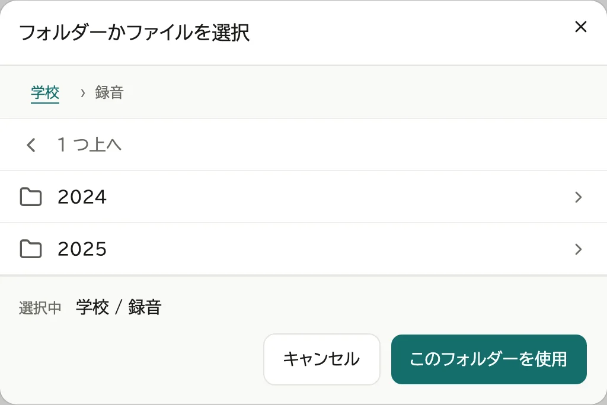
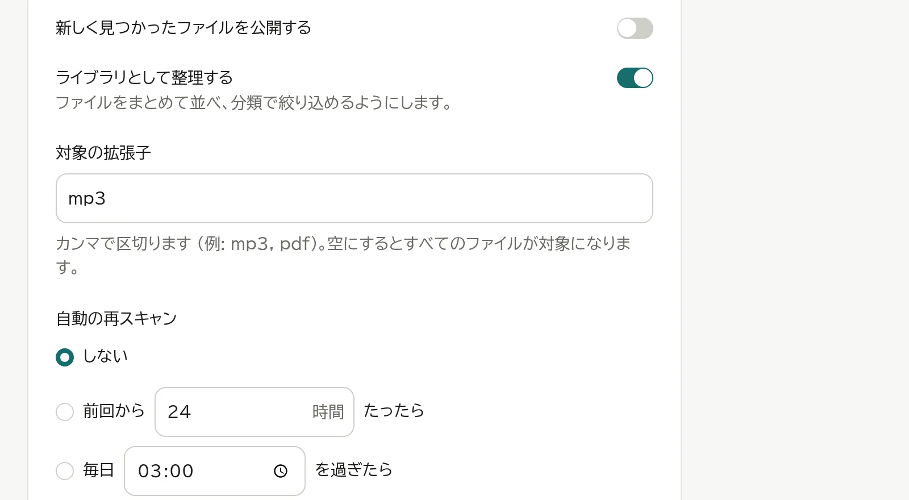
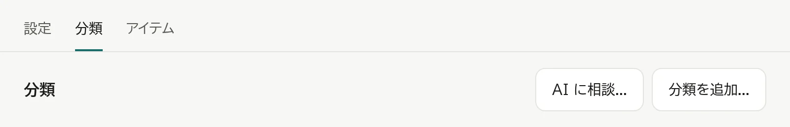
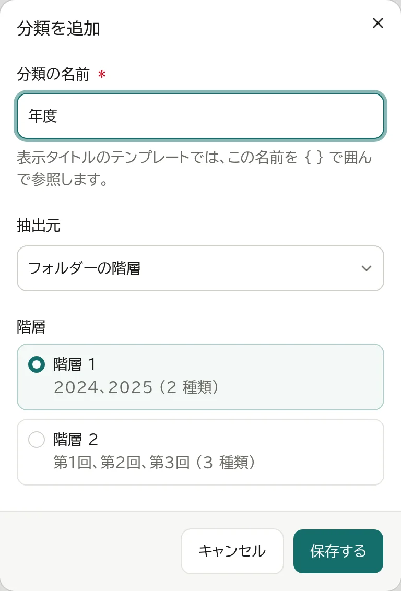
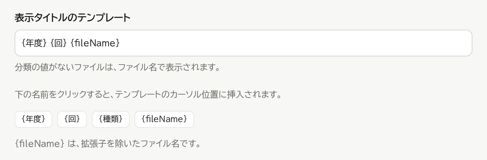
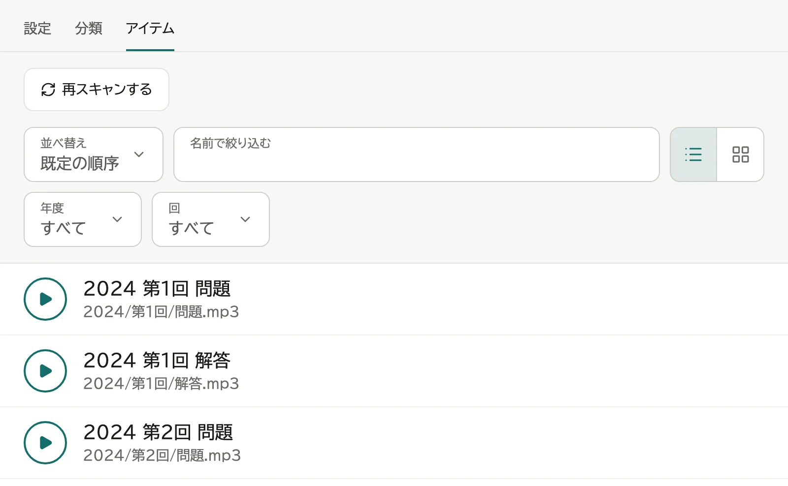
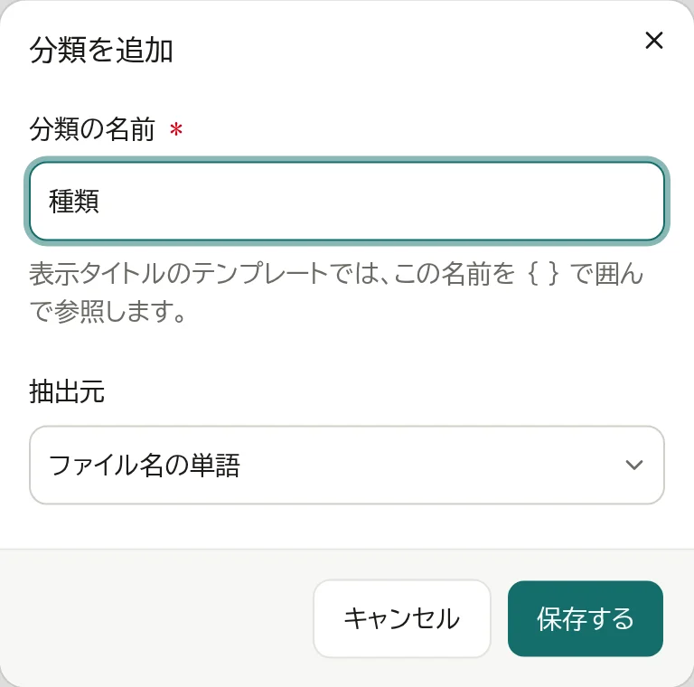
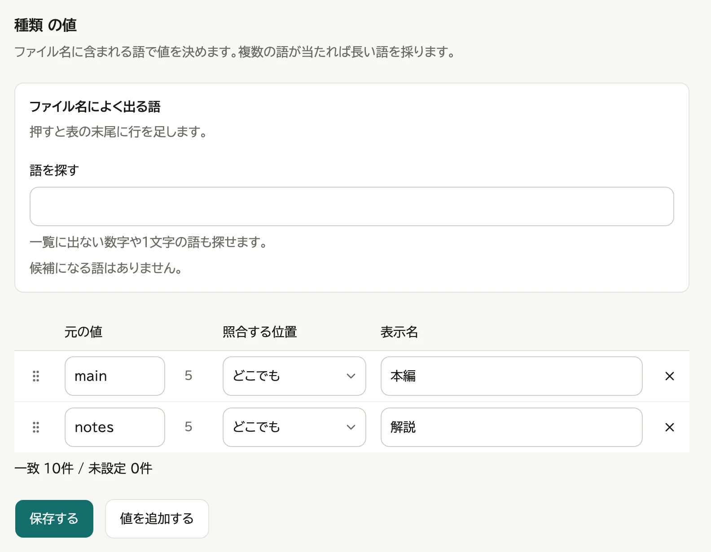
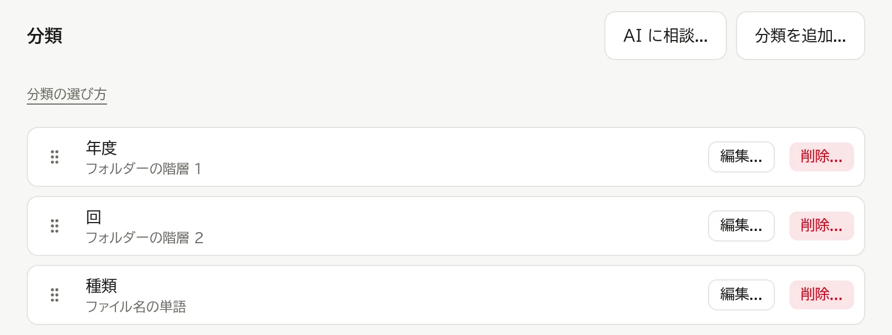

# ライブラリを設定する

ライブラリは、フォルダーの中のファイルを1つの一覧に並べ、「年度」「回」などで絞り込めるようにしたものです。

追加の窓には出ません。フォルダーを指すショートカットを作り、編集ページで切り替えて作ります。切り替えても見える範囲は変わらず、戻すこともできます。

フォルダーには、2つの見方があります。

- フォルダー: コンピューターの中の階層をそのまま辿る。いつでも使えます。
- 一覧: 中のファイルを1つの一覧に並べ、「年度」「回」などで絞り込めるようにする。使うかどうかを、フォルダーごとに決めます。

ライブラリとして整理すると、見る人の画面の見出しの下に「フォルダー」と「ライブラリ」が出て、見方を切り替えられます。ホームやグループから開くと、ライブラリが開きます。

このページの設定は、そのフォルダーを登録した人と管理者ができます。
ほかの人が登録したフォルダーは、見ることだけができます。変更するときは、管理者に頼みます。

## 例: 年度と回で絞り込む

次のように並んだファイルの場合です。

```
録音
├─ 2024
│   ├─ 第1回
│   │   └─ main.mp3
│   └─ 第2回
└─ 2025
```

1. 「コンテンツ」の「コンテンツを追加...」で「ショートカット」を選び、「選択...」を押す

   

2. `録音` のフォルダーを開き、「このフォルダーを使用」を押す

   

3. 「追加する」を押し、確認の窓で「登録する」を押す。ショートカットの編集ページが開きます
4. 「設定」のタブの「場所と見せ方」で「ライブラリとして整理する」をオンにし、その区画の「保存する」を押す。すぐにフォルダーをスキャンし、ボタンの横に進み具合が出ます。種類の表示が「ライブラリ」に変わります

   
5. 「分類」のタブを押し、「分類を追加...」を押す

   

6. 分類名に「年度」を入れ、抽出元は「フォルダーの階層」、階層は「階層 1」を選び、「保存する」を押す

   

7. もう一度「分類を追加...」を押し、分類名「回」、階層「階層 2」で保存する
8. 「表示タイトルのテンプレート」を `{年度} {回} {fileName}` にし、「保存する」を押す

   

9. 「アイテム」のタブを押し、並んだファイルを確かめる

   

見せるものを絞るときは、「設定」のタブの対象か除外のパターンに書くか、見せるものだけを別のフォルダーに置いて登録します (→ [コンテンツを登録する](06-register-content.md))。

「分類」と「アイテム」のタブは、ライブラリのときだけ出ます。変更できる人には「対象外」のタブも出ます。

## ファイル名の語で分ける

ファイル名に含まれる語 (例: `main`・`notes`) で分けるときです。

1. 「分類を追加...」を押し、分類名を入れ、抽出元に「ファイル名の単語」を選び、「保存する」を押す

   

2. 追加した分類の行を押す
3. 「値を追加」を押し、元の値 (`main`) と表示名 (「本編」) を入れる。語の数だけ繰り返し、「保存する」を押す

   

「一致位置」で、語がファイル名のどこにあれば当てるかを選べます。

- どこでも (既定): ファイル名のどこかに含まれていれば当てる
- 先頭か区切りの直後: ファイル名の先頭か、英数字以外 (記号・空白・日本語など) の直後にあるときだけ当てる
- 末尾: ファイル名の最後か、拡張子の直前にあるときだけ当てる

拡張子も照らすので、拡張子で分けたいときは `.md` や `.pdf` のように点を付けて登録します。

## 日付で分ける

ファイルの日付の年や月で分けるときは、「分類を追加...」で抽出元に「年 (ファイルの日付)」か「月 (ファイルの日付)」を選びます。写真は撮影日を使い、撮影日の無いファイル (動画や文書など) はファイルの更新日を使います。値は `2024` や `06` の形になります。月は年を問わず、どの年の6月も `06` にまとまります。年と月の両方の分類を作れば、閲覧画面で年だけ・月だけ・年と月の両方のどれでも絞り込めます。

フォルダーの階層の分類と同じく、分類の行を押して開く値の表で、表示名 (`06` を `6月` にする など) と並び順を変えられます。

## 載せるファイルを絞る

「設定」のタブの「対象のパターン」(例: `*.mp3`) と「除外のパターン」で、見せるファイルを絞ります (→ [コンテンツを登録する](06-register-content.md))。保存するとすぐ効きます。除外を外したときも、再スキャンは要りません。

### 外れたファイルを確かめる

「対象外」のタブに、パターンで外れて見る人の画面に出ないファイルがパスで並びます。「名前で絞り込む」はパスに当たります。ファイルは開きません。中身は共有の画面で確かめます。名前がドットで始まるファイルとシンボリックリンクは並びません。

### 絞り込みからパターンを足す

「アイテム」か「対象外」のタブで「名前で絞り込む」に語を入れると、「パターンに追加...」が出ます。

1. 「パターンに追加...」を押す
2. 追加先 (「除外」か「対象」) を選ぶ
3. 語から作ったパターン (`jpg` なら `*jpg*`、`英語 2024` なら `*英語*2024*`) を、必要なら直す
4. 変わる件数を確かめて「追加する」を押す。その場で保存されます

「名前で絞り込む」はタイトルにも当たり、パターンはパスに当たるので、パターンが1件も当たらないことがあります。窓の件数で分かります。

## AI に考えてもらう

分類の決め方に迷ったら、お使いの AI のサービス (ChatGPT・Claude など) に考えてもらえます。WebLAV が AI に送ることはなく、プロンプトと答えを自分で貼り付けます。

1. 「分類」のタブで「AI に相談...」を押す
2. プロンプトをコピーし、AI のサービスに貼り付けて送る。プロンプトにはファイルのパスが入るので、人の名前などが入っていないかを確かめてください
3. AI の答えを「AI の回答を貼り付ける」の欄に貼り付け、「確認」を押す
4. 分類ごとに値が決まるファイルの数と、表示タイトルの例を見て、よければ「インポートする」を押す。直すときは「戻る」で答えの欄に戻る

インポートすると、今の分類と表示タイトルは置き換わります。インポートした後は、ほかの分類と同じように直せます。

## 分類を直す・削除する

「分類」のタブで、分類の行の「編集...」か「削除...」を押します。



「編集...」で開く画面では、次も決められます。

- 絞り込みに出す: オフにすると、見る人の絞り込みに出さない。表示タイトルと並び順には使う。オンでも、見せるファイルにこの分類の値が1つも無いうちは出ない
- 値が無ければファイル名のまま表示する: オフにすると、値の無いファイルはその部分を空にしてタイトルを組み立てる

抽出元か階層を変えて保存すると、その分類の値の表は消えます。

## 並び順を変える

- 絞り込みの並び: 「分類」のタブで、分類の行の頭にあるつまみをドラッグする
- 値の並び: 値の表の行の頭にあるつまみをドラッグする

## ファイルを足した・消したとき

一覧を開くと、前のスキャンから中身の変わったフォルダーだけを読み直します。足したファイルは再スキャンしなくても一覧に出て、消したファイルは一覧から外れます。

ファイルの中身を書き換えたとき (同じ名前のまま写真を差し替えた など) は、再スキャンで読み直します。

1. ライブラリの編集ページの見出しの右の「再スキャンする」を押す (スマートフォンでは見出しの右の「⋮」の中にあります)

   ファイルが多いと時間がかかり、見出しの下に進み具合と経過時間が出ます。画面を閉じても、スキャンは最後まで続きます。止めるときは「中止する」を押します。ファイルを読み始めた後なら、読んだファイルは一覧に入り、次のスキャンはその続きから進みます。

自動で再スキャンするときは、「設定」のタブの「自動の再スキャン」で「前回から○時間たったら」か「毎日○○を過ぎたら」を選び、時間か時刻を入れます。NAS を使う人の少ない夜中の時刻にしておくと、ほかの人の邪魔になりません。

## ファイルやフォルダーが見つからないとき

再スキャンで次のように出たときは、アイテムの一覧は変わっていません。

- **「フォルダーが見つかりませんでした。」**: 登録したフォルダーを消したか、移したか、名前を変えたか、外付けのドライブを外しています。
  - 移したか名前を変えたなら、「設定」のタブの「パス」の「変更...」を押して選びます。一覧の中身は消え、読み直します。
  - ドライブを外したなら、つないでから再スキャンします。
  - 見る人の画面にも「フォルダーが見つかりませんでした。」と出ます。
- **「「(フォルダー)」を読み取れませんでした。」「フォルダーを読み取れませんでした。」**: WebLAV がそのフォルダー (後のほうは登録したフォルダーそのもの) を読めません。コンピューターでそのフォルダーのアクセス権を確かめ、読めるようにしてから再スキャンします。NAS の共有フォルダーなら、つながっているかを確かめます。
