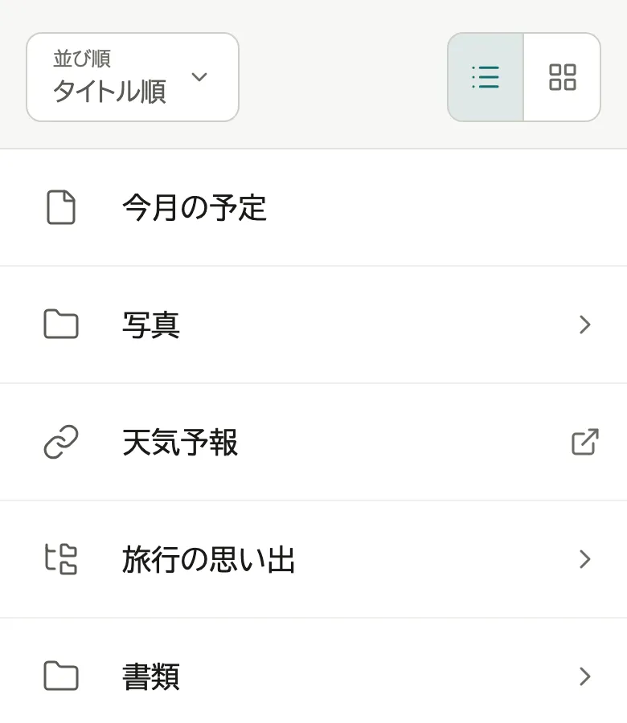
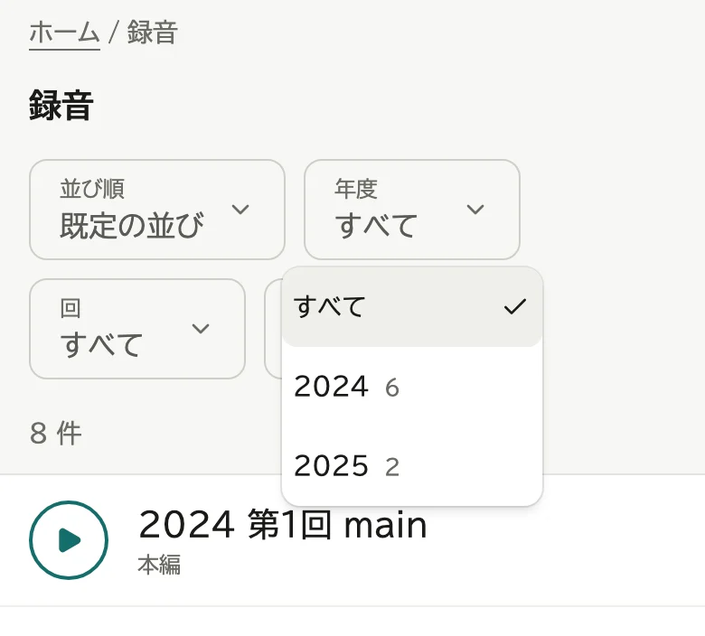
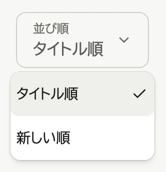
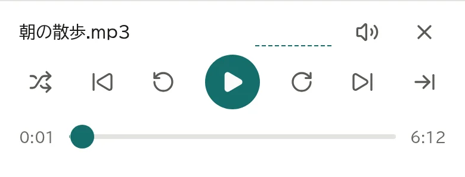
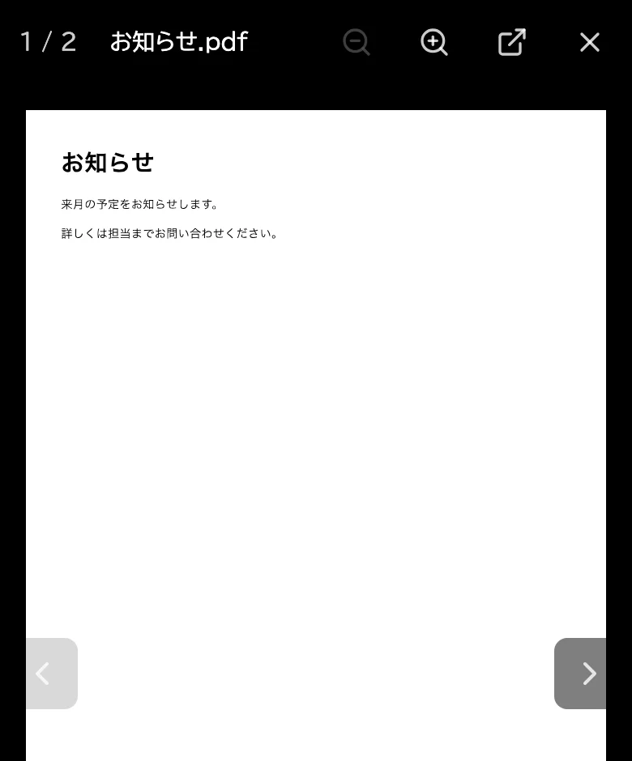

# ファイルを見る

## 開く

WebLAV を動かしているコンピューターと同じ Wi-Fi につないだデバイスで、教えてもらったアドレスを開くか、QR コードを読み取ります。

アドレスと QR コードは、WebLAV の画面右上の共有のアイコンを押して「QR コードを表示...」を選ぶと出ます。出るのは開いているページのアドレスなので、フォルダーなどを開いてから押すと、そのページを直接開いてもらえます。

ログインした人にだけ見えるものもあります (→ [ログインと表示](03-account.md))。

## 探す

- 「›」の付いた行を押すと、中に入ります。

  

- 上の「ホーム」などを押すと、戻ります。
- 見出しの下に「フォルダー」と「一覧」が出ているフォルダーでは、押して見方を切り替えます。「フォルダー」は中のフォルダーを辿り、「一覧」は中のファイルを1つの一覧に並べます。
- 選択肢 (「年度」など) を押して値を選ぶと、当てはまるものだけが残ります。

  

- 「並べ替え」で、タイトル順と新しい順を切り替えます。一覧の表示では「既定の順序」も選べます。

  

- 「絞り込み」の欄に打つと、名前に当たる行だけが残ります。打った文字がその順に名前に含まれていれば、間が空いていても当たります (「英リス2」で「英検 リスニング 第2回」)。当たった文字は色が変わります。
- 「並べ替え」の右のボタンで、リストとタイルを切り替えます。タイルにすると、広い画面に多く並びます。選んだ形は、このデバイスで覚えます。
- 画面右上の虫眼鏡のアイコンを押して語を打つと、コンテンツはタイトルと説明から、一覧の表示を使うフォルダーのファイルはタイトルと年度などの値から探せます。空白で区切ると、どの語も含むものに絞れます。全角と半角、大文字と小文字は区別しません。フォルダーの中のファイルとフォルダーは名前から、名前が `.links.toml` で終わるファイルの中のリンクはページのタイトルと説明 (`note`) から探せます。
  - グループ・フォルダーを開いているときに押すと、その中から探します。入力欄の下の「すべての場所」を押すと、全体から探します。

## 再生する・開く

- 音声を押すと、画面の下で鳴ります。

  

- 画像・PDF・動画・テキスト・Word・Excel・PowerPoint を押すと、その場で開きます。左右のボタンやスワイプで前後のファイルへ移れます。
- 印刷や保存は、上の矢印のボタンで新しいタブに開いてから行います。

  

- 動画は、YouTube と同じキーでも操作できます (スペースか K で再生・一時停止、J・L で10秒戻す・進む、M でミュート、F で全画面、Home・End で先頭・末尾、0〜9 で全体の 0〜90% の位置)。

- リンクを押すと、画像・題・説明を大きく出した画面が開きます。「新しいタブで開く」を押すと、リンク先が新しいタブで開きます。左下の左右のボタンで、前後のリンクへ移れます。リンク先が PDF・動画・音声・画像などのファイルなら、ファイルと同じようにその場で開きます。名前が `.links.toml` で終わるファイルを押すと、中のリンクが並びます。
