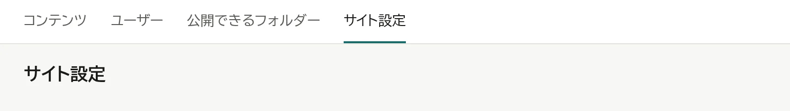
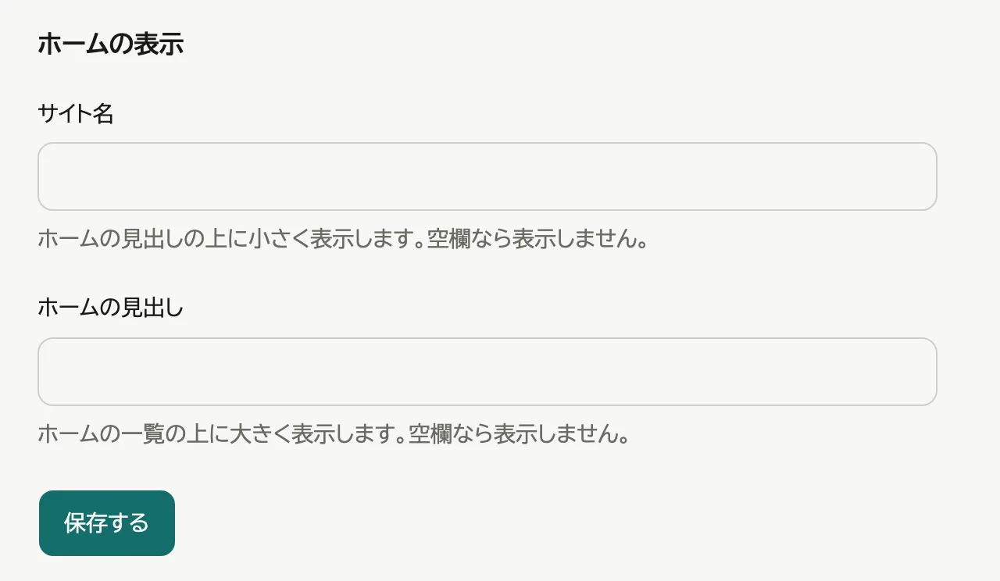
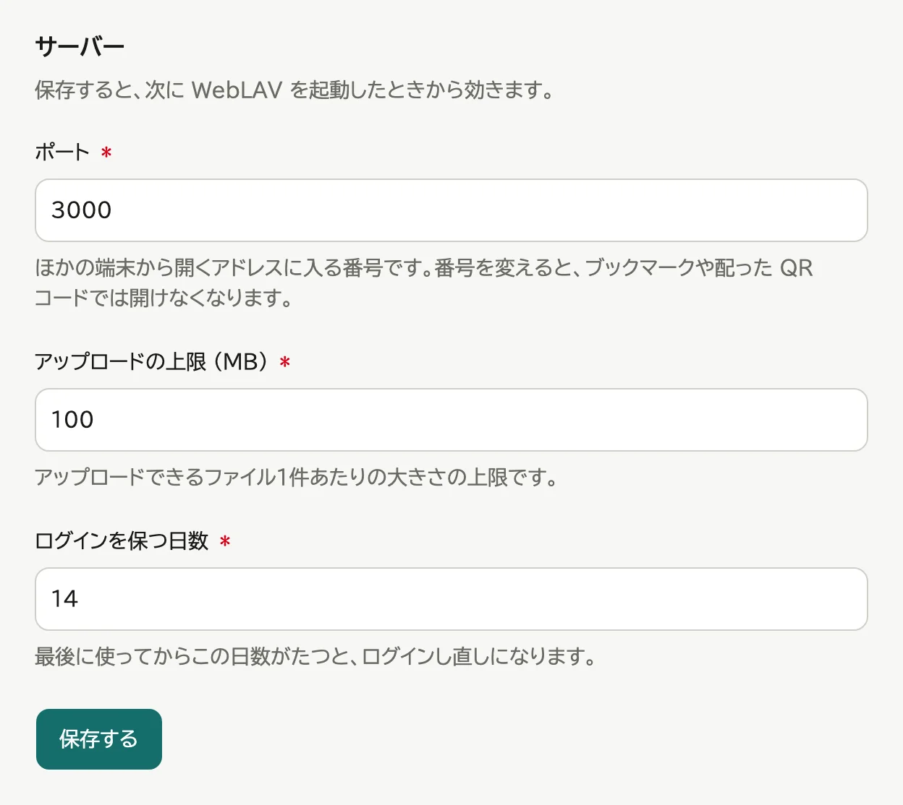
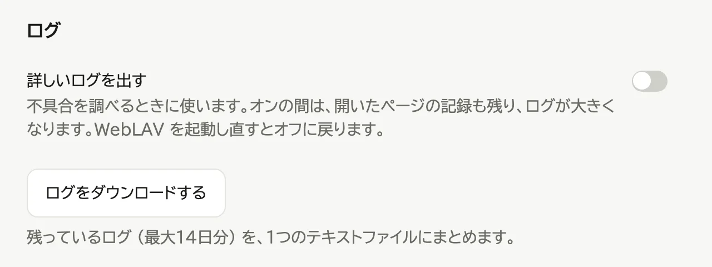
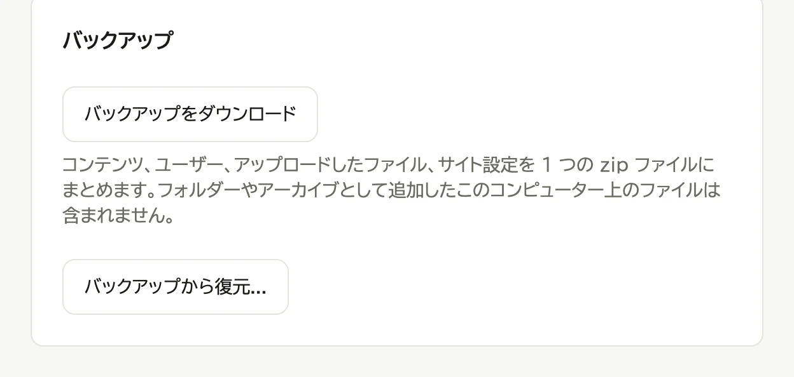

# 運用する

## 起動する・終了する

- 起動: スタートメニュー (macOS は「アプリケーション」フォルダー) から WebLAV を開く
- 終了: 通知領域 (macOS はメニューバー、Ubuntu は画面右上) の WebLAV アイコンから「終了する」を選ぶ

  

コンピューターにサインインしている間だけ動きます。

## サイトの設定を変える

管理ページの「サイト設定」のタブで変えます。

- ホームの表示: サイト名とホームの見出し。空にすると出しません。

  

- サーバー: ポート、アップロード上限 (MB)、ログインを維持する期間 (日)。変更は、次回の WebLAV 起動時に有効になります。
  既定の値から変えた項目には「既定値に戻す」が出ます。押して保存すると、元の値に戻ります。

  

- ログ: 「詳細ログ」は不具合を調べるときに使います。WebLAV を起動し直すとオフに戻ります。
  「ログをダウンロード」で、最大14日分のログを1つのファイルにまとめて保存できます。

  

## バックアップを取る・戻す

1. 管理ページの「サイト設定」のタブを押す

   

2. 「バックアップ」の欄で、取るときは「バックアップをダウンロード」、戻すときは「バックアップから復元...」を押す

   

公開しているフォルダーの中のファイルは含みません。

## アップデートする

- **Windows**: Microsoft Store が自動でアップデートする
- **macOS**: WebLAV を終了し、`WebLAV.app` を新しいものに置き換える

設定とデータは引き継がれます。

## バージョンを確かめる

管理ページの「サイト設定」のタブのいちばん下、「WebLAV について」に出ます。問い合わせのときは、括弧の中の数字まで含めてお知らせください。

## アンインストールする

- **Windows**: 「設定」→「アプリ」から WebLAV をアンインストールする
- **macOS**: 「ログイン時に起動」をオフにして終了し、`WebLAV.app` をゴミ箱に入れる

公開しているフォルダーの中のファイルは消えません。

**Windows では、設定とデータ (ユーザー・登録したコンテンツ・アップロードしたファイル) も消えます。** 入れ直して使い続けるなら、先に上の「バックアップを取る・戻す」でバックアップを取っておきます。

## 設定とデータの置き場所

| OS | 設定 | データ |
|---|---|---|
| Windows | `%LOCALAPPDATA%\Packages\amiiby.WebLAV_tv82n7df3ay6j\LocalCache\Roaming\amiiby\weblav\config` | `%LOCALAPPDATA%\Packages\amiiby.WebLAV_tv82n7df3ay6j\LocalCache\Local\amiiby\weblav\data` |
| macOS | `~/Library/Containers/com.amiiby.weblav/Data/Library/Application Support/com.amiiby.weblav` | 設定と同じ |
| Ubuntu | `~/.config/weblav` | `~/.local/share/weblav` |

環境変数 `WEBLAV_HOME` を指定すると、その場所にまとめて置かれます。
