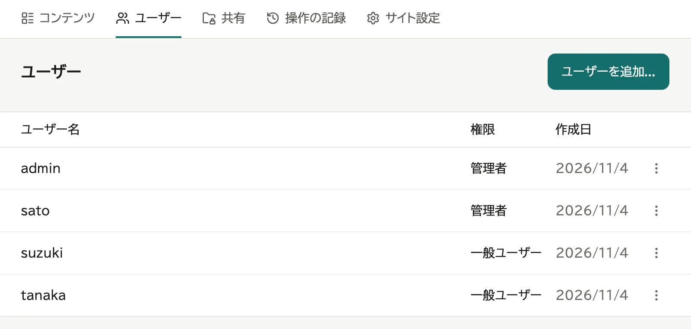
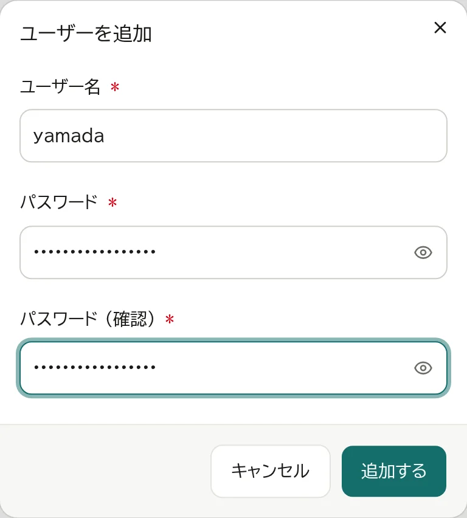
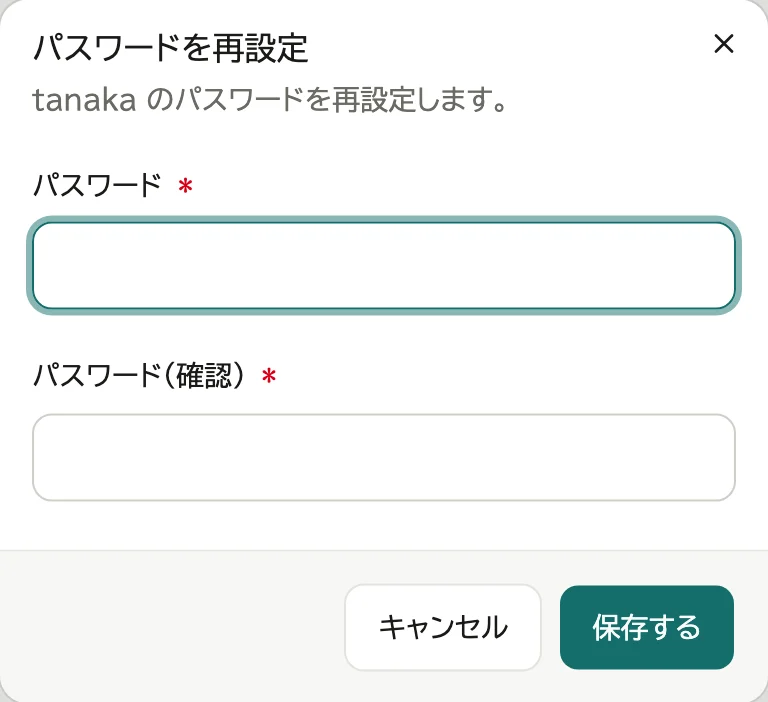
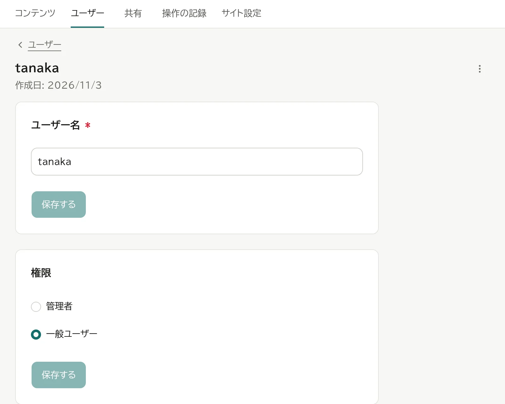
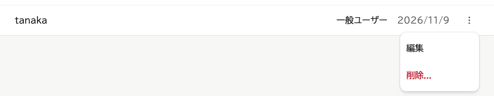
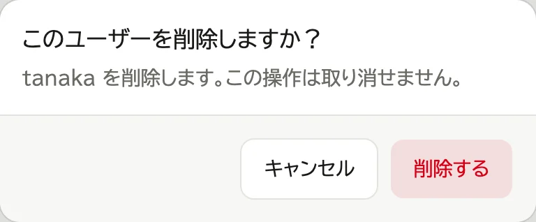

# ユーザーを管理する

## 追加する

1. 管理ページの「ユーザー」のタブで「ユーザーを追加...」を押す

   

2. ユーザー名とパスワードを決めて入れ、「追加する」を押す

   

追加すると、そのユーザーの編集ページが開きます。管理者にするときは、続けて「権限」で「管理者」を選び、「保存する」を押します (→ 下の「ユーザー名と権限を変える」)。

## 権限

- **一般ユーザー**: コンテンツを登録できます。変更・削除できるのは、自分が登録したものだけです。
  ほかの人が登録したものは変更できません。管理ページは開けません。
- **管理者**: すべてのコンテンツを変更・削除できます。そのほかに、ユーザー・共有・サイト設定を管理できます。

自分のユーザー名とパスワードは、ほかの人と同じく「アカウント」で変えます (→ [ログインと表示](03-account.md))。「ユーザー」の一覧の自分の行には「(あなた)」と付き、押しても開きません。自分を一般ユーザーにするときと、自分を削除するときは、ほかの管理者に頼みます。

一般ユーザーが共有の中でできること (見る・足す・動かす・消す) は、共有ごとに決めます。人によって変えるときは、管理ページの「共有」で、共有の行を押して開く編集ページの、「権限」の欄の「ユーザーごとの例外」でその人を足して権限を選びます (→ [共有を追加する](04-shares.md))。管理者は、どの共有でもすべての操作ができます。

## パスワードを再設定する

パスワードを忘れた人がいたら、管理者が新しいパスワードを決めて伝えます。

1. 「ユーザー」の一覧で、その人の行を押して編集ページを開く
2. ユーザー名の右の「⋮」を押し、「パスワードを再設定...」を選ぶ
3. 新しいパスワードを入れ、「保存する」を押す

   

再設定すると、その人のリカバリコードは使えなくなります。本人に作り直してもらいます。

リカバリコードを持っている人は、自分で再設定することもできます (→ [ログインと表示](03-account.md))。管理者が1人だけなら、その管理者のパスワードはリカバリコードでしか再設定できません。

## ユーザー名と権限を変える

1. 「ユーザー」の一覧で、その人の行を押す (編集ページが開く)
2. 「ユーザー名」か「権限」を変え、その欄の「保存する」を押す

   

ユーザー名を変えたら、本人には、次から新しいユーザー名でログインするよう伝えます。控えたリカバリコードで戻すときも、新しいユーザー名を入れます。本人が自分で変えることもできます (→ [ログインと表示](03-account.md))。

## 削除する

1. 「ユーザー」の一覧で、行の「⋮」を押し、「削除...」を選ぶ (編集ページのいちばん下の「削除」の区画からも選べます)

   

2. 「削除する」を押す

   

削除した人が登録したコンテンツは残り、管理者しか変更できなくなります。
公開範囲が「作成者のみ」のものは、「非表示」に変わります。また見せるときは、管理者がコンテンツの編集ページの「公開範囲」で選び直します。
引き継ぐ人がいれば、コンテンツの編集ページの「作成者」でその人を選び、「保存する」を押します。
共有の中でその人が行った操作の記録は残ります。
